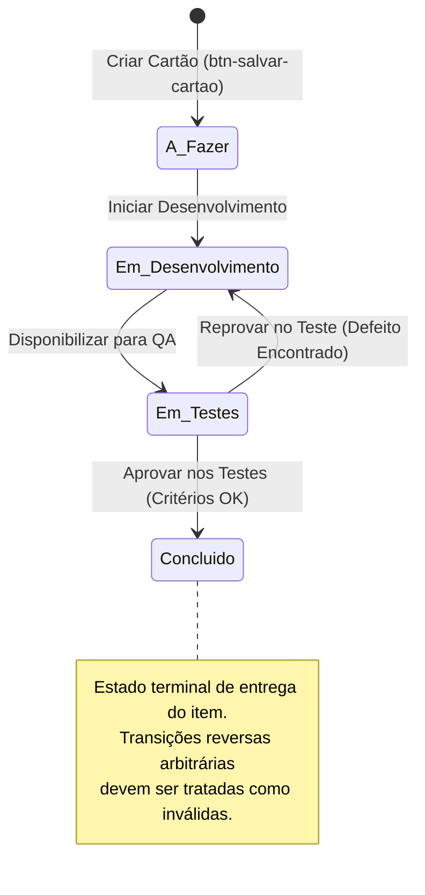
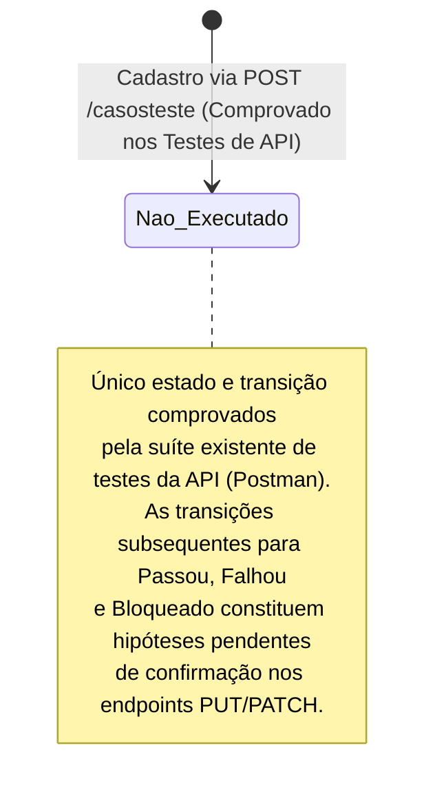
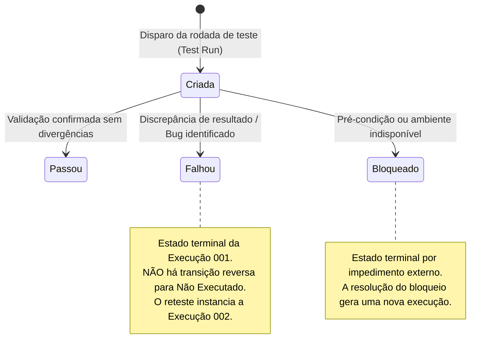

# 🎯 Técnicas de Projeto de Testes (Test Design Techniques)

> **Projeto:** TestBoard - Sistema de Gestão de Projetos e Casos de Teste  
> **Documento de Origem:** [requirements-analysis.md](requirements-analysis.md)  
> **Autor:** Entony Maxwell (QA Engineer)  
> **Padrão Metodológico:** ISTQB Foundation Level (CTFL) / ISO/IEC/IEEE 29119-4:2021  
> **Versão:** 1.0  
> **Status:** Aprovado para Especificação de Casos de Teste

---

## 1. Introdução e Propósito do Documento

A qualidade da automação de testes depende diretamente da solidez do seu projeto de testes (_Test Design_). Automatizar sem projetar adequadamente pode resultar em testes redundantes, scripts frágeis e falsas impressões de cobertura. Além disso, a execução repetitiva dos mesmos testes sem revisão ou evolução pode levar ao _Pesticide Paradox_, reduzindo a capacidade da suíte de identificar novos defeitos.

O objetivo deste documento é formalizar a aplicação sistemática de **quatro técnicas de teste de caixa-preta (baseadas em especificação)** e **uma abordagem complementar de teste exploratório baseada em experiência, estruturada por sessões (SBTM)**, alinhado ao syllabus ISTQB CTFL v4.0.1:

|   #   | Técnica de Teste                                | Categoria Metodológica |       Requisitos Cobertos       |    Prioridade    | Objetivo Principal                                                                                                                    |
| :---: | :---------------------------------------------- | :--------------------: | :-----------------------------: | :--------------: | :------------------------------------------------------------------------------------------------------------------------------------ |
| **1** | **Particionamento de Equivalência (EP)**        |  Caixa-Preta (Espec.)  | `REQ-001`, `REQ-002`, `REQ-003` |     **Alta**     | Reduzir o volume infinito de dados de entrada em classes representativas finitas com comportamento idêntico.                          |
| **2** | **Análise de Valor-Limite (BVA)**               |  Caixa-Preta (Espec.)  |      `REQ-002`, `REQ-003`       |     **Alta**     | Focar nas fronteiras das partições, regiões reconhecidamente propensas a defeitos de implementação (_off-by-one_ e descontinuidades). |
| **3** | **Tabela de Decisão (DTT)**                     |  Caixa-Preta (Espec.)  |      `REQ-001`, `REQ-002`       |     **Alta**     | Mapear sistematicamente as combinações relevantes de entradas lógicas e regras de negócio booleanas.                                  |
| **4** | **Transição de Estados (STT)**                  |  Caixa-Preta (Espec.)  |      `REQ-003`, `REQ-005`       |     **Alta**     | Garantir que o ciclo de vida dos cartões no Kanban e o status dos testes respeitem transições válidas e bloqueiem estados inválidos.  |
| **5** | **Teste Exploratório Baseado em Sessão (SBTM)** | Baseada em Experiência | `REQ-002`, `REQ-003`, `REQ-006` | **Complementar** | Descobrir defeitos não contemplados pela especificação através de heurísticas estruturadas e timeboxed.                               |

---

## 2. Técnica 1: Particionamento de Equivalência (Equivalence Partitioning - EP)

### 2.1 Justificativa Metodológica

O Particionamento de Equivalência divide o domínio de entrada de cada parâmetro em partições onde todos os valores de uma mesma partição são tratados pelo sistema da mesma forma. Identifica-se pelo menos **uma Partição Válida** (que deve ser processada com sucesso) e **uma ou mais Partições Inválidas** (que devem ser rejeitadas com erro apropriado).

---

### 2.2 Aplicação 1: Nome do Projeto (`REQ-002`)

- **Requisito de Origem:** `REQ-002` (Gestão de Projetos)
- **Regra Analisada:** `RN-002.1` — O nome do projeto (`titulo` na API / `project-name-input` na UI) é obrigatório e deve possuir entre 3 e 100 caracteres.
- **Campo Alvo:** Input textual `Nome do Projeto`

|   ID Partição   |        Tipo         | Descrição da Partição                                 | Valor Representativo (Dado de Teste)       | Resultado Esperado                                                                                            | Status / Mensagem                                                               |
| :-------------: | :-----------------: | :---------------------------------------------------- | :----------------------------------------- | :------------------------------------------------------------------------------------------------------------ | :------------------------------------------------------------------------------ |
| **EP-002.1-V1** |       Válida        | Nome com comprimento entre 3 e 100 caracteres         | `"Plataforma QA 2026"` (18 caracteres)     | O projeto é salvo e exibido no grid                                                                           | HTTP 201 / `"Projeto criado com sucesso"`                                       |
| **EP-002.1-I1** |      Inválida       | Nome com menos de 3 caracteres (abaixo do mínimo)     | `"QA"` (2 caracteres)                      | Bloqueio do cadastro                                                                                          | HTTP 400 / Mensagem de validação de tamanho mínimo                              |
| **EP-002.1-I2** |      Inválida       | Nome com mais de 100 caracteres (acima do máximo)     | String gerada com 105 caracteres `"A"*105` | Bloqueio do cadastro                                                                                          | HTTP 400 / Mensagem de validação de tamanho máximo                              |
| **EP-002.1-I3** |  Inválida [As-Is]   | Campo de nome obrigatório vazio (`""`)                | `""`                                       | Na UI: submissão interceptada antes do envio.<br>Na API: HTTP 400 caso disparado diretamente com campo vazio. | UI: `"O nome do projeto é obrigatório."` / API: `HTTP 400 Bad Request`          |
| **EP-002.1-I4** | Inválida [Pendente] | Campo preenchido exclusivamente por espaços em branco | `"   "` (3 espaços)                        | Bloqueio após trim ou rejeição                                                                                | [Pendente de Confirmação]: Depende da aplicação de sanitização (trim) na API/UI |

---

### 2.3 Aplicação 2: Descrição do Projeto (`REQ-002`)

- **Requisito de Origem:** `REQ-002` (Gestão de Projetos)
- **Regra Analisada:** `RN-002.2` — O campo `Descrição` é opcional e aceita texto livre de até 500 caracteres.
- **Campo Alvo:** Textarea `Descrição` (`project-desc-input` na UI / `"descricao"` na API)

|   ID Partição    |   Tipo   | Descrição da Partição                          | Valor Representativo (Dado de Teste)         | Resultado Esperado                                                                                      | Status / Mensagem                                        |
| :--------------: | :------: | :--------------------------------------------- | :------------------------------------------- | :------------------------------------------------------------------------------------------------------ | :------------------------------------------------------- |
| **EP-002.2-V1a** |  Válida  | Campo omitido no payload JSON (opcional)       | Payload sem a chave `"descricao"`            | O projeto é salvo com sucesso e a coluna `descricao` é persistida como `null` no banco de dados         | HTTP 201 / `"Projeto criado com sucesso"`                |
| **EP-002.2-V1b** |  Válida  | String vazia explícita (opcional)              | `""` (vazio) no textarea da UI ou API        | O projeto é salvo com sucesso com o campo normalizado (nulo ou vazio)                                   | HTTP 201 / `"Projeto criado com sucesso"`                |
| **EP-002.2-V2**  |  Válida  | Texto com comprimento entre 1 e 500 caracteres | Parágrafo com 120 caracteres                 | O projeto é salvo com a descrição formatada                                                             | HTTP 201 / `"Projeto criado com sucesso"`                |
| **EP-002.2-I1**  | Inválida | Texto com mais de 500 caracteres               | Texto com 550 caracteres gerado via Faker.js | Na UI: bloqueio do cadastro com aviso de limite.<br>Na API: HTTP 400 Bad Request se enviado diretamente | UI: Mensagem informando limite / API: `HTTP 400 Bad Req` |

---

### 2.4 Aplicação 3: Formato do E-mail e Obrigatoriedade no Login (`REQ-001`)

- **Requisito de Origem:** `REQ-001` (Autenticação e Sessão)
- **Regras Analisadas:**
  - `RN-001.1` — E-mail é campo de preenchimento obrigatório.
  - `RN-001.2` — Validação de formato convencional de e-mail (estrutura válida `usuario@dominio.tld`).
- **Campo Alvo:** Input `E-mail` (`input-email` na UI / `"email"` na API)

|   ID Partição   |   Tipo   | Regra Base | Descrição da Partição                 | Valor Representativo (Dado de Teste) | Resultado Esperado                                                                                                     | Status / Mensagem                                                                                                                                   |
| :-------------: | :------: | :--------: | :------------------------------------ | :----------------------------------- | :--------------------------------------------------------------------------------------------------------------------- | :-------------------------------------------------------------------------------------------------------------------------------------------------- |
| **EP-001.2-V1** |  Válida  | `RN-001.2` | Formato de e-mail padrão válido       | `qa@teste.com`                       | Formato aceito; fluxo de autenticação prossegue normalmente para validação das credenciais                             | UI:Campo reconhecido como válido pela validação de formato. / API: Requisição encaminhada para validação das credenciais, sem rejeição por formato. |
| **EP-001.2-V2** |  Válida  | `RN-001.2` | E-mail com subdomínio ou alias        | `qa+automacao@mail.empresa.com.br`   | Formato aceito; fluxo de autenticação prossegue normalmente para validação das credenciais                             | UI:Campo reconhecido como válido pela validação de formato. / API: Requisição encaminhada para validação das credenciais, sem rejeição por formato. |
| **EP-001.2-I1** | Inválida | `RN-001.2` | Ausência de caractere `@`             | `usuario.teste.com`                  | Na UI: formato rejeitado com mensagem no campo.<br>Na API: `HTTP 400 Bad Request` se enviado diretamente no payload.   | UI: Mensagem de formato inválido / API: `HTTP 400 Bad Request`                                                                                      |
| **EP-001.2-I2** | Inválida | `RN-001.2` | Ausência de domínio após o `@`        | `usuario@`                           | Na UI: formato rejeitado com mensagem no campo.<br>Na API: `HTTP 400 Bad Request` se enviado diretamente no payload.   | UI: Mensagem de formato inválido / API: `HTTP 400 Bad Request`                                                                                      |
| **EP-001.2-I3** | Inválida | `RN-001.2` | Ausência de destinatário antes do `@` | `@dominio.com`                       | Na UI: formato rejeitado com mensagem no campo.<br>Na API: `HTTP 400 Bad Request` se enviado diretamente no payload.   | UI: Mensagem de formato inválido / API: `HTTP 400 Bad Request`                                                                                      |
| **EP-001.1-I1** | Inválida | `RN-001.1` | Campo obrigatório de e-mail vazio     | `""`                                 | Na UI: formulário impede submissão com aviso.<br>Na API: `HTTP 400 Bad Request` se enviado com campo ausente ou vazio. | UI: `"Preencha todos os campos..."` / API: `HTTP 400 Bad Req`                                                                                       |

---

### 2.5 Aplicação 4: Código da História de Usuário (`REQ-003`)

- **Requisito de Origem:** `REQ-003` (Quadro Kanban / Cartões)
- **Regra Analisada:** `RN-003.2` — Código alfanumérico obrigatório no formato prefixado regex `^US-[0-9]{1,6}$`.
- **Campo Alvo:** Input `Código do Cartão` (`input-codigo-cartao` na UI / `"codigo"` na API)

|   ID Partição   |   Tipo   | Descrição da Partição                     | Valor Representativo     | Resultado Esperado              | Status / Mensagem                                                         |
| :-------------: | :------: | :---------------------------------------- | :----------------------- | :------------------------------ | :------------------------------------------------------------------------ |
| **EP-003.1-V1** |  Válida  | Prefixo `US-` com 1 a 6 dígitos numéricos | `US-001` ou `US-123456`  | Cartão criado na coluna inicial | HTTP 201 / `"Nova funcionalidade criada!"`                                |
| **EP-003.1-I1** | Inválida | Prefixo correto sem números               | `US-`                    | Bloqueio do cadastro            | `"O código deve seguir o padrão US- seguido de 1 a 6 dígitos numéricos."` |
| **EP-003.1-I2** | Inválida | Prefixo incorreto ou ausente              | `ABC-001` ou `12345`     | Bloqueio do cadastro            | `"O código deve seguir o padrão US- seguido de 1 a 6 dígitos numéricos."` |
| **EP-003.1-I3** | Inválida | Mais de 6 dígitos numéricos               | `US-1234567` (7 dígitos) | Bloqueio do cadastro            | `"O código deve seguir o padrão US- seguido de 1 a 6 dígitos numéricos."` |
| **EP-003.1-I4** | Inválida | Campo de código vazio                     | `""`                     | Modal permanece aberto          | Mensagem de campo obrigatório                                             |

---

### 2.6 Aplicação 5: Seletor de Prioridade do Cartão (`REQ-003`)

- **Requisito de Origem:** `REQ-003` (Quadro Kanban / Cartões)
- **Regra Analisada:** `RN-003.3` — Domínio discreto enumerado contendo apenas: `"Baixa"`, `"Média"`, `"Alta"`.
- **Campo Alvo:** Dropdown `select-prioridade-cartao`

|   ID Partição   |   Tipo   | Descrição da Partição     | Valor Representativo      | Resultado Esperado                             |
| :-------------: | :------: | :------------------------ | :------------------------ | :--------------------------------------------- |
| **EP-003.2-V1** |  Válida  | Prioridade Baixa          | `"Baixa"`                 | Cartão criado com badge visual azul/verde      |
| **EP-003.2-V2** |  Válida  | Prioridade Média          | `"Média"`                 | Cartão criado com badge visual amarelo/laranja |
| **EP-003.2-V3** |  Válida  | Prioridade Alta           | `"Alta"`                  | Cartão criado com badge visual vermelho        |
| **EP-003.2-I1** | Inválida | Valor fora do enum na API | `"Urgente"` ou `"Normal"` | Rejeição com HTTP 400 Bad Request              |

---

## 3. Técnica 2: Análise de Valor-Limite (Boundary Value Analysis - BVA)

### 3.1 Justificativa Metodológica

A Análise de Valor-Limite complementa o Particionamento de Equivalência ao focar nas **bordas e transições das partições**. Falhas em software ocorrem com maior frequência nos operadores de comparação (`<` em vez de `<=`, `>` em vez de `>=` e erros de _off-by-one_).

Utiliza-se aqui a técnica de **três valores de fronteira para domínios ordenados**, considerando os valores imediatamente abaixo, no limite e imediatamente acima de cada fronteira:

- Fronteira inferior: $min - 1$, $min$, $min + 1$
- Fronteira superior: $max - 1$, $max$, $max + 1$

---

### 3.2 Aplicação 1: Comprimento do Nome do Projeto (`REQ-002`)

- **Regra Analisada:** Intervalo válido $[3, 100]$ caracteres (domínio discreto $n \in \mathbb{N}$).
- **Valores de Fronteira:** Limite Inferior = 3; Limite Superior = 100.

| Ponto de Teste |    Comprimento     | Valor Representativo               |   Condição   | Resultado Esperado         | Justificativa Técnica                                                                                                   |
| :------------: | :----------------: | :--------------------------------- | :----------: | :------------------------- | :---------------------------------------------------------------------------------------------------------------------- |
| **$min - 1$**  |  **2 caracteres**  | `"PR"`                             | **Inválido** | Bloqueio / Erro de tamanho | Testa se a validação barra abaixo do mínimo permitido                                                                   |
|   **$min$**    |  **3 caracteres**  | `"APP"`                            |  **Válido**  | Sucesso (HTTP 201)         | Testa o limite exato inferior permitido                                                                                 |
| **$min + 1$**  |  **4 caracteres**  | `"TEST"`                           |  **Válido**  | Sucesso (HTTP 201)         | Testa o primeiro ponto interno seguro                                                                                   |
| **$max - 1$**  | **99 caracteres**  | String de 99 caracteres `"A"*99`   |  **Válido**  | Sucesso (HTTP 201)         | Testa o último ponto interno seguro                                                                                     |
|   **$max$**    | **100 caracteres** | String de 100 caracteres `"B"*100` |  **Válido**  | Sucesso (HTTP 201)         | Testa o limite máximo permitido pela regra de negócio (`RN-002.1`)                                                      |
| **$max + 1$**  | **101 caracteres** | String de 101 caracteres `"C"*101` | **Inválido** | Bloqueio / Erro de tamanho | Verifica se o sistema rejeita entradas acima do limite especificado, evitando truncamento ou persistência inconsistente |

---

### 3.3 Aplicação 2: Limite da Descrição do Projeto (`REQ-002`)

- **Regra Analisada:** Limite máximo de 500 caracteres.
- **Valores de Fronteira:** $max - 1 = 499$, $max = 500$, $max + 1 = 501$.

| Ponto de Teste |    Comprimento     | Valor Representativo            |   Condição   | Resultado Esperado | Justificativa Técnica                             |
| :------------: | :----------------: | :------------------------------ | :----------: | :----------------- | :------------------------------------------------ |
| **$max - 1$**  | **499 caracteres** | Texto com 499 caracteres        |  **Válido**  | Sucesso (HTTP 201) | Validação segura próxima da fronteira             |
|   **$max$**    | **500 caracteres** | Texto com exatos 500 caracteres |  **Válido**  | Sucesso (HTTP 201) | Capacidade máxima declarada pela regra de negócio |
| **$max + 1$**  | **501 caracteres** | Texto com 501 caracteres        | **Inválido** | Bloqueio com aviso | Valida a aplicação estrita do limite impeditivo   |

---

### 3.4 Aplicação 3: Quantidade de Dígitos do Código do Cartão (`REQ-003`)

- **Regra Analisada:** Prefixo `US-` acompanhado de 1 até 6 dígitos numéricos.

| Ponto de Teste | Quantidade de Dígitos | Valor do Código |   Condição   | Resultado Esperado                                 |
| :------------: | :-------------------: | :-------------- | :----------: | :------------------------------------------------- |
| **$min - 1$**  |     **0 dígitos**     | `"US-"`         | **Inválido** | Rejeição por formato incompleto                    |
|   **$min$**    |     **1 dígito**      | `"US-1"`        |  **Válido**  | Sucesso (HTTP 201) - Identificador aceito          |
| **$min + 1$**  |     **2 dígitos**     | `"US-10"`       |  **Válido**  | Sucesso (HTTP 201)                                 |
| **$max - 1$**  |     **5 dígitos**     | `"US-12345"`    |  **Válido**  | Sucesso (HTTP 201)                                 |
|   **$max$**    |     **6 dígitos**     | `"US-123456"`   |  **Válido**  | Sucesso (HTTP 201) - Limite superior aceito        |
| **$max + 1$**  |     **7 dígitos**     | `"US-1234567"`  | **Inválido** | Rejeição: excede o tamanho máximo do identificador |

---

## 4. Técnica 3: Tabela de Decisão (Decision Table Testing - DTT)

### 4.1 Justificativa Metodológica

A Tabela de Decisão é ideal para testar regras de negócio que combinam **múltiplas condições lógicas (booleanas)** com diferentes ações esperadas do sistema. Cada coluna representa uma **Regra de Decisão ($R_1, R_2, \dots$)**.

---

### 4.2 Tabela de Decisão 1: Fluxo de Autenticação (`REQ-001`)

#### Condições (Entradas)

- **C1:** E-mail preenchido?
- **C2:** Senha preenchida?
- **C3:** E-mail existe na base de dados?
- **C4:** Senha informada confere com o hash cadastrado?

#### Ações (Resultados)

- **A1:** Emitir token JWT e autorizar sessão?
- **A2:** Redirecionar para `/projetos` e exibir "TestBoard"?
- **A3:** Exibir erro `"Usuário ou senha inválidos."`?
- **A4:** Exibir erro `"Preencha todos os campos obrigatórios."`?
- **A5:** Retornar código HTTP na API?

| Condições / Ações                            | Regra 1 (R1) | Regra 2 (R2) | Regra 3 (R3) | Regra 4 (R4)  | Regra 5 (R5)  | Regra 6 (R6)  |
| :------------------------------------------- | :----------: | :----------: | :----------: | :-----------: | :-----------: | :-----------: |
| **C1: E-mail preenchido**                    |     Sim      |     Sim      |     Sim      |      Não      |      Sim      |      Não      |
| **C2: Senha preenchida**                     |     Sim      |     Sim      |     Sim      |      Sim      |      Não      |      Não      |
| **C3: E-mail cadastrado**                    |     Sim      |     Não      |     Sim      |       -       |       -       |       -       |
| **C4: Senha correta**                        |     Sim      |      -       |     Não      |       -       |       -       |       -       |
| **A1: Emitir JWT**                           |    **X**     |      -       |      -       |       -       |       -       |       -       |
| **A2: Navegar `/projetos`**                  |    **X**     |      -       |      -       |       -       |       -       |       -       |
| **A3: Erro `"Usuário ou senha inválidos."`** |      -       |    **X**     |    **X**     |       -       |       -       |       -       |
| **A4: Erro `"Preencha todos os campos..."`** |      -       |      -       |      -       |     **X**     |     **X**     |     **X**     |
| **A5: Código HTTP na API (`POST /login`)**   |   `200 OK`   | `401 Unauth` | `401 Unauth` | `400 Bad Req` | `400 Bad Req` | `400 Bad Req` |

> **Nota de QA sobre Segurança e Contratos:**
>
> 1. Observe que as Regras R2 e R3 produzem exatamente a mesma ação externa (A3), preservando a regra de negócio `RN-001.3` contra ataques de enumeração de contas (_Account Enumeration_).
> 2. Nas Regras R4, R5 e R6, na interface web o formulário bloqueia a submissão e renderiza `"Preencha todos os campos obrigatórios."` antes do envio. Caso a requisição seja disparada diretamente contra a API (`POST /login`) com campos ausentes ou vazios, o contrato rejeita o payload com `HTTP 400 Bad Request`.

---

### 4.3 Tabela de Decisão Reduzida — Criação e Validação de Projetos (`REQ-002`)

> **Nota Metodológica:** Esta é uma **Tabela de Decisão Reduzida**. Ela contempla exclusivamente as regras e combinações representativas selecionadas a partir das regras de negócio prioritárias, considerando condições irrelevantes e a precedência das validações, sem representar uma cobertura exaustiva de todas as $2^4 = 16$ combinações matematicamente possíveis.

#### Condições

- **C1:** Usuário autenticado com token JWT válido?
- **C2:** Nome do projeto preenchido com comprimento válido $[3, 100]$?
- **C3:** Descrição dentro do limite permitido ($\le 500$ caracteres)?
- **C4:** Nome do projeto é inédito para a conta do usuário? `[Pendente]`

#### Ações

- **A1:** Persistir projeto no banco de dados?
- **A2:** Exibir notificação `"Projeto criado com sucesso"` na UI?
- **A3:** Exibir erro de validação de tamanho/obrigatoriedade do nome?
- **A4:** Exibir erro de limite da descrição?
- **A5:** Exibir mensagem de duplicidade de nome? `[Pendente]`
- **A6:** Código HTTP retornado na API (`POST /projetos`)

| Condições / Ações                      | R1 (Caminho Feliz) | R2 (Sem Auth) | R3 (Nome Inválido) | R4 (Desc Longa) | R5 (Duplicado [Pendente]) |
| :------------------------------------- | :----------------: | :-----------: | :----------------: | :-------------: | :-----------------------: |
| **C1: Token JWT Válido**               |        Sim         |    **Não**    |        Sim         |       Sim       |            Sim            |
| **C2: Nome Válido [3, 100]**           |        Sim         |       -       |      **Não**       |       Sim       |            Sim            |
| **C3: Descrição $\le$ 500**            |        Sim         |       -       |        Sim         |     **Não**     |            Sim            |
| **C4: Nome Inédito [Pendente]**        |        Sim         |       -       |       **-**        |       Sim       |          **Não**          |
| **A1: Salvar Projeto**                 |       **X**        |       -       |         -          |        -        |             -             |
| **A2: Notificação Sucesso**            |       **X**        |       -       |         -          |        -        |             -             |
| **A3: Erro no Nome**                   |         -          |       -       |       **X**        |        -        |             -             |
| **A4: Erro na Descrição**              |         -          |       -       |         -          |      **X**      |             -             |
| **A5: Rejeição Duplicidade**           |         -          |       -       |         -          |        -        |           **X**           |
| **A6: Código HTTP (`POST /projetos`)** |   `201 Created`    | `401 Unauth`  |   `400 Bad Req`    |  `400 Bad Req`  |      `409 Conflict`       |

> **Nota sobre a Regra R5 [Pendente de Confirmação]:** A regra de unicidade do nome do projeto (`RN-002.4`) e a resposta `HTTP 409 Conflict` estão classificadas como pendentes na Análise de Requisitos v2.2. O cenário R5 foi incluído na tabela para formalizar a especificação de teste antecipada para quando a restrição de banco for homologada, não representando cobertura de comportamento As-Is atual.  
> **Nota sobre Precedência de Validação [Pendente de Validação]:** Caso o usuário informe simultaneamente Nome Inválido e Descrição Acima do Limite, a validação de Nome possui precedência na interface gráfica (o modal mantém o foco e alerta o nome obrigatório/inválido antes da descrição), enquanto na API o validador de schema pode reportar ambos os erros em lote ou priorizar a primeira propriedade violada.

---

## 5. Técnica 4: Transição de Estados (State Transition Testing - STT)

### 5.1 Justificativa Metodológica

A técnica de Transição de Estados é fundamental quando o comportamento do sistema depende do **estado atual** da entidade e de **eventos que provocam transições para novos estados**. Garante que:

1. Todas as transições válidas sejam testadas com sucesso;
2. Todas as transições proibidas (inválidas) sejam bloqueadas pelo sistema;
3. Exista rigor metodológico ao separar o que já está implementado (_As-Is_) do que é desenho de arquitetura proposto (_To-Be_).

---

### 5.2 Aplicação 1: Ciclo de Vida do Cartão no Quadro Kanban (`REQ-003`)

> **Classificação:** _Modelo Proposto de Transição de Estados — To-Be / Pendente de Validação_  
> **Contexto de Requisitos:** Conforme estabelecido no `REQ-003` (`RN-003.4 [As-Is]` e `RN-003.5 [Pendente]`), a implementação atual confirma a alocação do cartão recém-criado na coluna inicial (`A Fazer` / `Backlog`). O fluxo completo entre raias e as restrições de transição descritas abaixo constituem uma **proposta de qualidade (To-Be)** que deve ser formalmente homologada junto ao Product Owner e à equipe de desenvolvimento.

#### Diagrama de Estados Proposto para o Cartão Kanban



#### Tabela de Cobertura de Transição de Estados (Matriz de Transição Proposta)

| Estado Atual             | Evento / Disparador                               | Próximo Estado Esperado |        Validade         | Resultado Esperado do Teste                                             |
| :----------------------- | :------------------------------------------------ | :---------------------- | :---------------------: | :---------------------------------------------------------------------- |
| **Inexistente**          | Criação com sucesso via modal                     | `A Fazer`               |   **Válida [As-Is]**    | Cartão persistido via `POST /cartoes` e renderizado na primeira coluna  |
| **`A Fazer`**            | Mover para Desenvolvimento                        | `Em Desenvolvimento`    |   **Válida [To-Be]**    | Status atualizado no backend e visualmente refletido no Kanban          |
| **`A Fazer`**            | Tentativa de pular diretamente para Concluído     | `A Fazer` (mantido)     | **Inválida [Proposta]** | Sistema impede o salto de fluxo sem evidência de desenvolvimento/testes |
| **`Em Desenvolvimento`** | Mover para validação de qualidade                 | `Em Testes`             |   **Válida [To-Be]**    | Cartão entra na fila de homologação do time de QA                       |
| **`Em Testes`**          | Testes aprovados (todos os CAs atendidos)         | `Concluído`             |   **Válida [To-Be]**    | Cartão migra para a coluna final de entrega                             |
| **`Em Testes`**          | Teste reprovado (abertura de bug)                 | `Em Desenvolvimento`    |   **Válida [To-Be]**    | Cartão retorna para correção com histórico de falha registrado          |
| **`Concluído`**          | Tentativa de mover para A Fazer sem justificativa | `Concluído` (mantido)   | **Inválida [Proposta]** | Bloqueio de regressão arbitrária de cartão finalizado                   |

---

### 5.3 Aplicação 2: Ciclo de Vida da Gestão de Testes (`REQ-005`)

Para evitar distorções entre a implementação real e a engenharia de qualidade recomendada, a modelagem de transição de estados é dividida em dois níveis conceituais:

---

#### 5.3.1 Modelo As-Is: Ciclo de Vida do Status Acoplado ao Caso de Teste

Na implementação atual da API (`POST /casosteste`), o atributo `status` é mantido diretamente no registro do próprio caso de teste, inicializado obrigatoriamente como `"Não Executado"`.

> **Aviso Metodológico de Rastreabilidade:** A suíte automatizada existente (Postman) comprova **exclusivamente a transição inicial de criação** para o status default `"Não Executado"`. As transições subsequentes de atualização (`PUT/PATCH`) para `"Passou"`, `"Falhou"` e `"Bloqueado"` constituem hipóteses de negócio derivadas do `REQ-005`, mas estão classificadas como **pendentes de confirmação na implementação**, aguardando verificação dos endpoints de atualização correspondentes no backend.



#### Matriz de Hipóteses de Transição As-Is (Pendentes de Confirmação na Implementação)

| Estado Inicial      | Evento na API / UI                | Estado Resultante |       Validade        | Comportamento e Rastreabilidade                                                           |
| :------------------ | :-------------------------------- | :---------------- | :-------------------: | :---------------------------------------------------------------------------------------- |
| **Inexistente**     | `POST /casosteste`                | `Não Executado`   |  **Válida [As-Is]**   | Inicialização padrão comprovada nos testes da API Postman                                 |
| **`Não Executado`** | Registro de teste com sucesso     | `Passou`          | **Válida [Pendente]** | Status do caso de teste é atualizado no banco                                             |
| **`Não Executado`** | Registro de teste com divergência | `Falhou`          | **Válida [Pendente]** | Status do caso de teste é atualizado no banco                                             |
| **`Não Executado`** | Registro de bloqueio técnico      | `Bloqueado`       | **Válida [Pendente]** | Status é alterado para Bloqueado                                                          |
| **`Passou`**        | Nova execução detecta regressão   | `Falhou`          | **Válida [Pendente]** | O status é sobrescrito para Falhou, apagando o sucesso anterior                           |
| **`Falhou`**        | Reteste aprovado após fix         | `Passou`          | **Válida [Pendente]** | O status anterior é sobrescrito, perdendo o histórico da falha (Débito Técnico `R-005.1`) |

---

#### 5.3.2 Modelo To-Be: Ciclo de Vida da Instância de Execução de Teste (`ExecucaoTeste` 1:N)

No modelo arquitetural To-Be, a especificação do caso de teste (`CasoDeTeste`) permanece imutável. Cada ciclo de teste instancia um novo registro de `ExecucaoTeste`, cujos estados finais são **terminais e imutáveis**. Uma execução que falhou permanece registrada como falha para fins de métricas e auditoria; a reavaliação gera uma **nova execução independente**.

```
Caso de Teste CT-001 (Especificação Mantida)
 ├── Execução 001: [Falhou]    -> Registro histórico imutável mantido
 └── Execução 002: [Passou]    -> Nova execução independente após correção do bug
```



| Estado da Execução | Evento                                               | Estado Resultante      |   Validade   | Regra de Auditoria (To-Be)                                                                                |
| :----------------- | :--------------------------------------------------- | :--------------------- | :----------: | :-------------------------------------------------------------------------------------------------------- |
| **Inexistente**    | Iniciar nova rodada de teste                         | `Criada`               |  **Válida**  | Instanciação de novo registro de execução com timestamp e executor                                        |
| **`Criada`**       | Todos os passos atendidos                            | `Passou`               |  **Válida**  | Estado final daquela execução gravado como sucesso permanente                                             |
| **`Criada`**       | Passo reprovado / defeito                            | `Falhou`               |  **Válida**  | Estado final daquela execução gravado como falha permanente                                               |
| **`Criada`**       | Impedimento externo detectado                        | `Bloqueado`            |  **Válida**  | Estado final daquela execução gravado como bloqueada por infraestrutura                                   |
| **`Passou`**       | Tentativa de sobrescrever status de execução passada | `Passou` (imutável)    | **Inválida** | Execuções concluídas com sucesso são somente leitura; novas rodadas de regressão instanciam novo registro |
| **`Falhou`**       | Tentativa de mudar status da execução passada        | `Falhou` (imutável)    | **Inválida** | Execuções passadas são somente leitura; retestes geram uma nova execução                                  |
| **`Bloqueado`**    | Tentativa de reabrir execução bloqueada              | `Bloqueado` (imutável) | **Inválida** | A resolução do impedimento gera uma nova instância de execução                                            |

> **Nota Metodológica sobre Evidências e Estados:**
>
> 1. A anexação de evidências (prints e logs de erro) é um **atributo descritivo** do registro de falha, e não um sub-estado interno da máquina de estados, evitando a imposição indevida de que toda falha exija obrigatoriamente um anexo para ser concluída.
> 2. O estado **Bloqueado** é terminal para aquela instância de execução pontual: se o ambiente voltar a operar, uma nova execução deve ser disparada em vez de reescrever a anterior.

---

## 6. Técnica 5: Teste Exploratório Baseado em Sessão (SBTM / Charters)

### 6.1 Justificativa Metodológica

O Teste Exploratório Baseado em Sessão (_Session-Based Test Management - SBTM_) complementa as técnicas formais através da **aprendizagem ativa, intuição técnica e investigação simultânea**. Não se trata de teste caótico (_ad-hoc_), mas de sessões delimitadas por tempo (_timeboxed_) com **Missões e Heurísticas de Teste** focadas em zonas de alto risco.

---

### 6.2 Sessão 1: Segurança, Injeção e Sanitização de Entradas (Charter 01)

| Item da Sessão               | Detalhes do Planejamento                                                                                                                                                                                                                                                                                                                                                                                                                                                                                                                                                                        |
| :--------------------------- | :---------------------------------------------------------------------------------------------------------------------------------------------------------------------------------------------------------------------------------------------------------------------------------------------------------------------------------------------------------------------------------------------------------------------------------------------------------------------------------------------------------------------------------------------------------------------------------------------- |
| **Charter (Missão)**         | Explorar os formulários de entrada de Projeto (`REQ-002`) e Cartões (`REQ-003`) com payloads de injeção de caracteres especiais, emojis, tags HTML e scripts, para verificar a sanitização e proteção contra Cross-Site Scripting (XSS) e SQL Injection.                                                                                                                                                                                                                                                                                                                                        |
| **Áreas Alvo**               | Nome do Projeto, Descrição do Projeto, Título do Cartão e Descrição do Cartão.                                                                                                                                                                                                                                                                                                                                                                                                                                                                                                                  |
| **Heurísticas Aplicadas**    | Injeção de tags `<script>alert('XSS')</script>`, formatação Markdown rica (`**negrito**`, `__itálico__`), emojis complexos (ex: 🚀👨‍💻🔥), caracteres e comandos SQL (`' OR '1'='1`, `'; DROP TABLE "Cartao"; --`).                                                                                                                                                                                                                                                                                                                                                                               |
| **Duração (Timebox)**        | 45 minutos.                                                                                                                                                                                                                                                                                                                                                                                                                                                                                                                                                                                     |
| **Massa de Dados**           | Caracteres Unicode UTF-8 de múltiplos bytes e strings de teste de segurança OWASP.                                                                                                                                                                                                                                                                                                                                                                                                                                                                                                              |
| **O que observar (Oráculo)** | • **Segurança XSS e Renderização:** A UI deve escapar tags no DOM, impedindo execução de scripts. Como as entradas são tratadas como texto simples, caracteres Markdown devem ser exibidos literalmente, sem formatação descontrolada ou quebra de layout.<br>• **Segurança SQL Injection:** Payloads SQL não devem alterar a lógica das consultas no backend (Prisma ORM), não devem permitir contorno de autenticação nem acesso indevido a dados de terceiros. A ausência de HTTP 500 não é o único indicador: a entrada deve ser persistida estritamente como string literal parametrizada. |

> **Salvaguarda Operacional de Segurança:** Os testes de injeção e payloads destrutivos (como `'; DROP TABLE "Cartao"; --`) devem ser executados **exclusivamente em ambiente local de desenvolvimento ou container isolado** com banco descartável (`tcc_db` local) e sementes de teste. É terminantemente proibida a execução desses payloads em ambientes de homologação compartilhados ou produção.

---

### 6.3 Sessão 2: Resiliência de Concorrência e Sobrecarga no Kanban (Charter 02)

| Item da Sessão               | Detalhes do Planejamento                                                                                                                                                                                                                                                                                                                                                                                                            |
| :--------------------------- | :---------------------------------------------------------------------------------------------------------------------------------------------------------------------------------------------------------------------------------------------------------------------------------------------------------------------------------------------------------------------------------------------------------------------------------- |
| **Charter (Missão)**         | Avaliar o comportamento do quadro Kanban (`REQ-003`) sob operações simultâneas e rápidas de movimentação de múltiplos cartões, simulando concorrência de acessos simultâneos sobre o mesmo projeto.                                                                                                                                                                                                                                 |
| **Áreas Alvo**               | Quadro Kanban (`/projetos/:id/kanban`), arrastar e soltar de cards e requisições de atualização de status.                                                                                                                                                                                                                                                                                                                          |
| **Heurísticas Aplicadas**    | Movimentação em lote rápida de cartões entre raias, múltiplos disparos com latência simulada de rede via Chrome DevTools (_Slow 3G_), concorrência via dois contextos independentes de navegador no Playwright (`browser.newContext()`) autenticados com a MESMA conta de usuário (respeitando a regra de isolamento multi-tenant `RN-002.3`, dado que o sistema não possui compartilhamento de projetos entre usuários distintos). |
| **Duração (Timebox)**        | 40 minutos.                                                                                                                                                                                                                                                                                                                                                                                                                         |
| **O que observar (Oráculo)** | As operações concorrentes devem respeitar a política de consistência adotada pelo sistema, sem corrupção dos dados, duplicação de cartões na UI ou erros 500 não tratados no backend. Eventuais conflitos e atualizações sobrescritas devem ser avaliados conforme a política de concorrência definida na aplicação (ex.: _last-write-wins_ ou controle otimista).                                                                  |

---

### 6.4 Sessão 3: Isolamento e Recuperação de Falhas no Reset de Banco (Charter 03)

| Item da Sessão               | Detalhes do Planejamento                                                                                                                                                                                                                                                                                                                                                                                                                                                                                                                                                                                                                                                                                                                                              |
| :--------------------------- | :-------------------------------------------------------------------------------------------------------------------------------------------------------------------------------------------------------------------------------------------------------------------------------------------------------------------------------------------------------------------------------------------------------------------------------------------------------------------------------------------------------------------------------------------------------------------------------------------------------------------------------------------------------------------------------------------------------------------------------------------------------------------- |
| **Charter (Missão)**         | Investigar a robustez do endpoint `/qa/reset-db` (`REQ-006`) sob condições extremas de concorrência e requisições malformadas, garantindo que o banco de dados nunca permaneça em estado inconsistente.                                                                                                                                                                                                                                                                                                                                                                                                                                                                                                                                                               |
| **Áreas Alvo**               | Endpoint administrativo `POST http://localhost:3001/qa/reset-db`.                                                                                                                                                                                                                                                                                                                                                                                                                                                                                                                                                                                                                                                                                                     |
| **Heurísticas Aplicadas**    | • Autenticação administrativa: token ausente, token com assinatura inválida, token truncado ou expirado.<br>• Contrato de chamada: disparo com método HTTP incorreto (ex: `GET` em vez de `POST`), corpo malformado ou header `Content-Type` inesperado.<br>• Concorrência: duas requisições de reset disparadas concorrentemente em paralelo com início sincronizado.<br>• Falha de rede: interrupção abrupta da conexão TCP durante a execução da operação.                                                                                                                                                                                                                                                                                                         |
| **Duração (Timebox)**        | 30 minutos.                                                                                                                                                                                                                                                                                                                                                                                                                                                                                                                                                                                                                                                                                                                                                           |
| **O que observar (Oráculo)** | • Após um reset bem-sucedido, o usuário padrão e as sementes previamente definidas devem estar presentes, enquanto as tabelas transacionais devem corresponder ao estado inicial esperado.<br>• Não devem existir registros órfãos ou violações de integridade referencial.<br>• Caso uma falha interrompa uma operação com atomicidade implementada, o banco deve retornar integralmente ao estado anterior por meio de rollback.<br>• Requisições concorrentes devem apresentar o comportamento esperado conforme o mecanismo de controle de concorrência implementado, sem deadlocks ou corrupção de dados.<br>_(Nota: Não exigir HTTP 409 ou rollback automático como comportamento As-Is atual enquanto essas proteções permanecerem classificadas como To-Be)._ |

---

## 7. Rastreabilidade com os Próximos Documentos do Portfólio

Os cenários projetados neste documento fornecem a base matemática e lógica para as etapas subsequentes do ciclo de testes:

1. **Especificação de Casos de Teste (`docs/test-cases.md`):**  
   Os cenários derivados das técnicas serão formalizados com identificadores únicos (`TC-001`, `TC-002`, etc.) e passos estruturados em formato BDD (_Given/When/Then_), observando a seguinte segregação metodológica:
   - **Cenários As-Is Confirmados:** Comporão a suíte de testes executável da versão atual, cobrindo tanto testes E2E de interface (Playwright) quanto contratos de integração (Postman/Newman).
   - **Cenários Pendentes e Propostas To-Be:** Serão documentados na especificação com status demarcado (_Pending/Proposed_), formalizando os critérios de aceite antecipados (_Shift-Left_) sem contabilização como cobertura funcional executável da versão atual até que sua implementação seja formalmente confirmada no backend/frontend.
   - **Sessões Exploratórias (SBTM):** Os charters não precisam ser convertidos individualmente em casos BDD rígidos; eles guiam sessões de teste exploratório estruturado por _timebox_, e os comportamentos relevantes ou defeitos identificados poderão originar novos casos de teste formais ou relatórios de bugs.

2. **Matriz de Rastreabilidade (`docs/traceability-matrix.md`):**  
   Mapeamento bidirecional completo entre todas as camadas da engenharia de qualidade:  
   `Requisito (REQ)` $\leftrightarrow$ `Regra de Negócio (RN)` $\leftrightarrow$ `Técnica de Projeto (EP/BVA/DTT/STT)` $\leftrightarrow$ `Caso de Teste (TC)` $\leftrightarrow$ `Automação (Playwright / Postman / k6)`.
