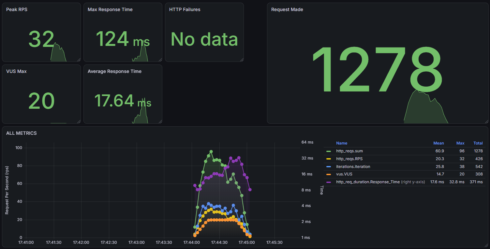
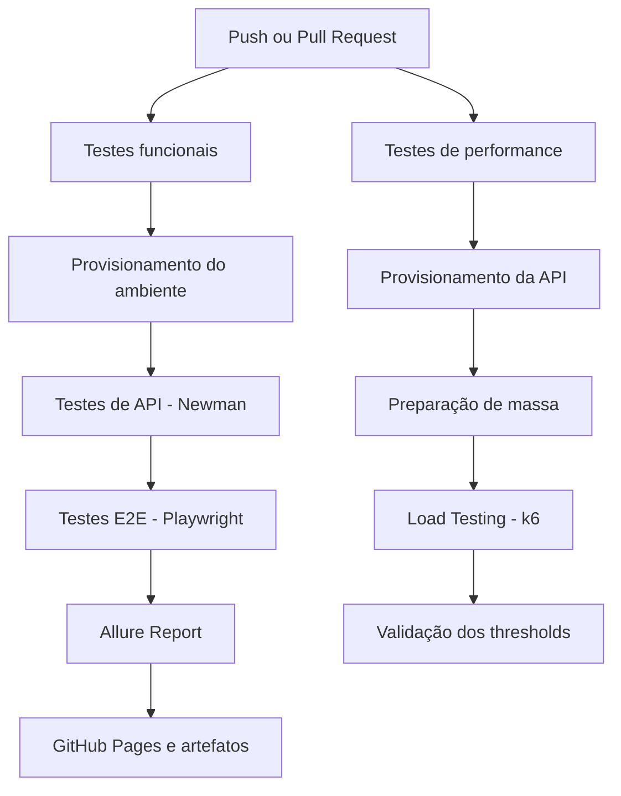

# 🧪 Engenharia de Testes e Quality Assurance — TestBoard

[](https://playwright.dev/)


[](https://entonymaxwell01.github.io/testes-projeto-tcc/)


## 📌 Sobre o projeto

Projeto de Quality Assurance e automação de testes aplicado ao **TestBoard**, sistema de gerenciamento de projetos, histórias de usuário, critérios de aceite e casos de teste desenvolvido como Trabalho de Conclusão de Curso (TCC) em Engenharia de Software.

O projeto utiliza uma aplicação Full-Stack própria, desenvolvida com React, Node.js, Prisma e PostgreSQL, como ambiente de validação.

Seu objetivo é aplicar práticas de engenharia de testes ao longo do ciclo de desenvolvimento de software, contemplando análise de requisitos, projeto de testes, automação, integração contínua, performance e geração de evidências.

## 🎯 Estratégia de qualidade

| Abordagem | Aplicação |
| --- | --- |
| Shift-Left Testing | Análise estática e refinamento de requisitos |
| Risk-Based Testing | Identificação e priorização de riscos |
| Test Design | Aplicação de técnicas de projeto de testes |
| Testes E2E | Validação de fluxos e comportamentos da interface |
| Testes de API | Validação de endpoints e integração entre recursos |
| Testes de resiliência | Simulação de falhas de servidor e conexão |
| Testes de acessibilidade | Verificações automatizadas com Axe-core |
| Testes de performance | Avaliação do comportamento da API sob carga |
| Continuous Testing | Execução automatizada em pipelines CI/CD |

## 📚 Documentação de QA

A documentação aplica conceitos de fundamentos de teste, análise de requisitos, gerenciamento de riscos e técnicas de projeto de testes.

| Documento | Descrição | Status |
| --- | --- | --- |
| [Análise de requisitos](docs/requirements-analysis.md) | Regras de negócio, critérios de aceite, premissas e análise de riscos | Disponível |
| [Técnicas de projeto de testes](docs/test-design-techniques.md) | Aplicação de técnicas de caixa-preta e planejamento exploratório | Disponível |
| Estratégia de testes | Definição de escopo, abordagem e critérios | Planejado |
| Casos de teste | Especificação dos cenários de validação | Planejado |
| Matriz de rastreabilidade | Associação entre requisitos, riscos e testes | Planejado |

### Técnicas de projeto de testes

- Particionamento de equivalência (EP).
- Análise de valor limite (BVA).
- Tabelas de decisão (DTT).
- Transição de estados (STT).
- Planejamento de testes exploratórios baseados em sessões (SBTM).

Os requisitos são classificados como **As-Is**, **To-Be** ou **Pendente**, diferenciando comportamentos existentes, melhorias propostas e pontos que ainda precisam de confirmação.

## 🛠️ Tecnologias e ferramentas

| Tecnologia | Aplicação |
| --- | --- |
| Playwright | Automação de testes E2E |
| TypeScript | Desenvolvimento com tipagem estática |
| Faker.js | Geração dinâmica de massa de dados |
| Postman | Desenvolvimento de testes de API |
| Newman | Execução automatizada de collections |
| Axe-core | Análise automatizada de acessibilidade |
| k6 | Testes de performance |
| Allure Report | Relatórios de execução e evidências |
| Grafana | Visualização de métricas |
| InfluxDB | Armazenamento de métricas de performance |
| Docker Compose | Provisionamento da infraestrutura de monitoramento |
| GitHub Actions | Integração contínua |
| PostgreSQL | Banco de dados do ambiente de testes |

## 🌐 Automação de testes E2E

Os testes de interface são desenvolvidos com Playwright e TypeScript, utilizando uma arquitetura modular baseada em Page Object Model (POM).

### Práticas de automação

- Page Object Model (POM).
- Custom Fixtures.
- Test Data Factory.
- Data-Driven Testing.
- Geração dinâmica de dados com Faker.js.
- Autenticação via API.
- Reutilização de sessão com `storageState`.
- Preparação de massa de testes via API.
- Seletores baseados em `data-testid`.
- Sincronização de testes com respostas da API.
- Interceptação e simulação de requisições.
- Captura de screenshots, vídeos e traces em caso de falha.

### Escopo dos testes

| Funcionalidade | Validações |
| --- | --- |
| Autenticação | Login válido e cenários negativos |
| Projetos | Cadastro, edição, exclusão e campos obrigatórios |
| Cartões | Criação de cartões vinculados a projetos |
| Resiliência | Erros HTTP 500, falhas de conexão e listas vazias |

### Testes cross-browser

A configuração do Playwright contempla os seguintes engines:

- Chromium.
- WebKit.

A pipeline de integração contínua executa atualmente os testes com Chromium.

## 🔌 Testes de API

Os testes de API são desenvolvidos com Postman e executados automaticamente com Newman.

A collection utiliza variáveis de ambiente, autenticação JWT e encadeamento de requisições para validar a integração entre diferentes recursos da aplicação.

### Recursos contemplados

- Reset da massa de testes.
- Autenticação e obtenção dinâmica de token JWT.
- Listagem e criação de projetos.
- Criação de cartões.
- Criação de casos de teste.
- Cadastro de critérios de aceite.

As validações incluem códigos de status HTTP, presença de tokens e identificadores retornados pela API, conforme os cenários implementados.

## ♿ Testes de acessibilidade

O projeto possui testes automatizados de acessibilidade utilizando Axe-core integrado ao Playwright.

As verificações contemplam regras associadas aos níveis A e AA das WCAG 2.0 e 2.1 nas telas de login e projetos.

Os resultados podem ser exportados em relatórios HTML com a identificação das violações encontradas.

> Os cenários de acessibilidade estão implementados, porém temporariamente desativados na suíte automatizada, enquanto essa frente de validação está em evolução.

## 📈 Testes de performance

Os testes de performance são desenvolvidos com k6 para avaliar o comportamento da API em diferentes condições de carga.

### Cenários disponíveis

| Cenário | Objetivo |
| --- | --- |
| Smoke Testing | Verificar o funcionamento básico sob carga mínima |
| Load Testing | Avaliar o comportamento sob carga esperada |
| Stress Testing | Investigar o comportamento sob carga elevada |
| Spike Testing | Avaliar a resposta a aumentos repentinos de carga |

Os cenários realizam operações de autenticação e consulta de projetos, utilizando usuários preparados previamente por um script de geração de massa de testes.

### Thresholds

| Métrica | Critério de aceitação | Cenário |
| --- | --- | --- |
| Latência P95 | Inferior a 500 ms | Load, Stress e Spike |
| Latência P99 | Inferior a 200 ms | Smoke |
| Taxa de falhas HTTP | Inferior a 1% | Todos |

Os thresholds permitem sinalizar resultados fora dos limites estabelecidos e retornar falhas na execução automatizada quando os critérios não são atendidos.

## 📊 Monitoramento e observabilidade

A infraestrutura de monitoramento utiliza Docker Compose para provisionar Grafana e InfluxDB.

As métricas geradas pelo k6 podem ser armazenadas no InfluxDB e visualizadas em dashboards no Grafana.

### Métricas analisadas

- Tempo de resposta.
- Latência por percentil.
- Throughput.
- Taxa de falhas HTTP.
- Volume de requisições.
- Usuários virtuais simultâneos.

<p align="center">
  
</p>

<p align="center">
  <em>Exemplo de monitoramento de métricas de performance da API com Grafana.</em>
</p>

## 📁 Arquitetura do projeto

```text
testes-projeto-tcc/
├── .github/
│   └── workflows/
│       ├── playwright.yml
│       └── performance.yml
├── api/
│   ├── newman/
│   └── testes-projeto-tcc.postman_collection.json
├── assets/
├── data/
├── docs/
│   ├── requirements-analysis.md
│   ├── test-design-techniques.md
│   ├── test-strategy.md
│   ├── test-cases.md
│   └── traceability-matrix.md
├── fixtures/
│   └── page-fixtures.ts
├── pages/
│   ├── CardPage.ts
│   ├── CommonPage.ts
│   ├── LoginPage.ts
│   └── ProjetosPage.ts
├── performance/
│   ├── config.js
│   ├── docker-compose.yml
│   ├── seed-perf-users.js
│   ├── smoke-test.js
│   ├── load-test.js
│   ├── stress-test.js
│   └── spike-test.js
├── tests/
│   ├── e2e/
│   │   ├── accessibility.spec.ts
│   │   ├── card.spec.ts
│   │   ├── login.spec.ts
│   │   └── projetos.spec.ts
│   └── setup/
│       └── auth.setup.ts
├── utils/
│   └── auth.ts
├── package.json
├── playwright.config.ts
└── tsconfig.json
```

### Organização das responsabilidades

| Diretório | Responsabilidade |
| --- | --- |
| `api/` | Collections e relatórios de testes de API |
| `assets/` | Recursos utilizados na documentação |
| `data/` | Dados utilizados nos testes parametrizados |
| `docs/` | Documentação e artefatos de QA |
| `fixtures/` | Injeção de dependências e preparação de massa |
| `pages/` | Encapsulamento das ações e validações de interface |
| `performance/` | Cenários, configurações e infraestrutura de performance |
| `tests/` | Especificações dos testes automatizados |
| `utils/` | Funções auxiliares reutilizáveis |
| `.github/workflows/` | Pipelines de integração contínua |

## ⚙️ Configuração do ambiente

### Pré-requisitos

- Node.js LTS.
- npm.
- Git.
- Docker e Docker Compose.
- k6.
- Java, para geração local de relatórios Allure.
- Acesso à aplicação TestBoard e ao banco de dados de testes.

### Instalação

```bash
git clone https://github.com/entonymaxwell01/testes-projeto-tcc.git

cd testes-projeto-tcc

npm ci

npx playwright install chromium webkit
```

### Variáveis de ambiente

Crie um arquivo `.env` na raiz do projeto:

```env
BASE_URL=http://localhost:5173
API_URL=http://localhost:3001

USER_EMAIL=
USER_PASSWORD=
QA_RESET_TOKEN=
```

Preencha as credenciais de acordo com o ambiente de testes.

> A aplicação TestBoard deve estar em execução antes da realização dos testes. Este repositório contém a suíte de QA, não o código-fonte completo da aplicação testada.

> Utilize exclusivamente ambientes de teste. O setup possui operações de reset do banco de dados.

## ▶️ Executando os testes

### Testes E2E

```bash
npx playwright test
```

Executar somente no Chromium:

```bash
npx playwright test --project=chromium
```

Executar no WebKit:

```bash
npx playwright test --project=webkit
```

Executar no modo interativo:

```bash
npx playwright test --ui
```

Visualizar relatório HTML:

```bash
npx playwright show-report
```

### Testes de API

Utilize o arquivo `api/Setup.postman_environment.example.json` como referência para criar o ambiente `api/Setup.postman_environment.json`.

Configure as variáveis necessárias e execute:

```bash
npm run test:api
```

### Testes de performance

Com a API em execução, prepare a massa de testes:

```bash
cd performance

node seed-perf-users.js
```

Execute o cenário desejado:

```bash
k6 run -e API_URL=http://localhost:3001 smoke-test.js

k6 run -e API_URL=http://localhost:3001 load-test.js

k6 run -e API_URL=http://localhost:3001 stress-test.js

k6 run -e API_URL=http://localhost:3001 spike-test.js
```

### Monitoramento com Grafana

Dentro do diretório `performance/`, execute:

```bash
docker compose up -d
```

Execute o teste enviando as métricas ao InfluxDB:

```bash
k6 run -e API_URL=http://localhost:3001 \
  --out influxdb=http://localhost:8086/k6 \
  load-test.js
```

Acesse o Grafana em:

```text
http://localhost:3000
```

Configure o InfluxDB como fonte de dados utilizando o endereço `http://influxdb:8086` e o banco `k6`.

## 🔄 Integração contínua (CI/CD)

O projeto utiliza GitHub Actions para automatizar a execução dos testes em ambientes isolados de integração contínua.

### Pipeline de testes funcionais

A pipeline contempla:

- Provisionamento do PostgreSQL.
- Inicialização do backend e frontend.
- Reset da massa de testes.
- Execução da collection Postman com Newman.
- Instalação das dependências de automação.
- Cache dos navegadores Playwright.
- Execução dos testes E2E no Chromium.
- Geração de relatórios Allure.
- Disponibilização de artefatos de execução.
- Publicação de relatórios no GitHub Pages.

### Pipeline de performance

A pipeline de performance contempla:

- Provisionamento do ambiente.
- Inicialização da API.
- Preparação de usuários para os testes.
- Execução automatizada do Load Testing com k6.
- Validação dos thresholds configurados.

### Fluxo de execução



## 📋 Relatórios e evidências

O projeto utiliza Allure Report e relatórios HTML para análise das execuções automatizadas.

As evidências incluem:

- Resultados dos testes.
- Cenários aprovados, reprovados e ignorados.
- Tempo de execução.
- Detalhamento de falhas.
- Screenshots, vídeos e traces.
- Relatórios de testes de API.
- Métricas de performance.

### Allure Report

[](https://entonymaxwell01.github.io/testes-projeto-tcc/)

Para gerar e visualizar o relatório localmente após executar os testes:

```bash
npm run allure:report
```

Os relatórios também são disponibilizados como artefatos nas execuções do GitHub Actions.

## 🗺️ Roadmap

- [x] Estruturação da arquitetura Page Object Model.
- [x] Implementação de Custom Fixtures.
- [x] Autenticação via API e reutilização de sessão.
- [x] Geração dinâmica de massa de testes.
- [x] Implementação de testes E2E.
- [x] Implementação de testes de API.
- [x] Interceptação de requisições e testes de resiliência.
- [x] Implementação de cenários de acessibilidade.
- [x] Implementação de Smoke, Load, Stress e Spike Testing.
- [x] Monitoramento com Grafana e InfluxDB.
- [x] Integração contínua com GitHub Actions.
- [x] Publicação de relatórios Allure.
- [x] Documentação de análise de requisitos e riscos.
- [x] Documentação de técnicas de projeto de testes.
- [ ] Consolidação da estratégia de testes.
- [ ] Documentação dos casos de teste.
- [ ] Matriz de rastreabilidade.
- [ ] Execução e documentação de sessões exploratórias.
- [ ] Validação de persistência com SQL.
- [ ] Validação de contratos de API com JSON Schema.
- [ ] Reativação dos testes de acessibilidade.
- [ ] Ampliação da cobertura funcional.
- [ ] Consolidação dos relatórios de qualidade.

## 👨‍💻 Autor

**Entony Maxwell**

[](https://www.linkedin.com/in/entony-maxwell/)
[](https://github.com/entonymaxwell01)
[](https://entonymaxwell01.github.io/)
